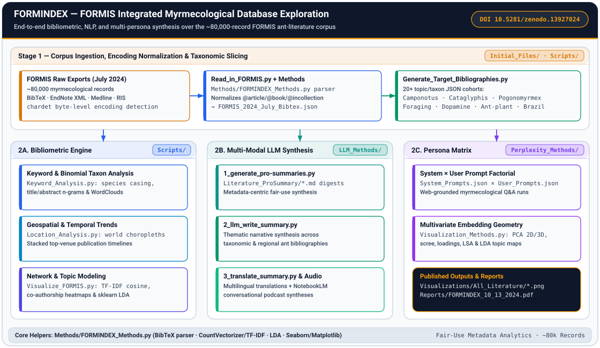

# FORMINDEX

FORMINDEX (FORMIS INtegrated Database EXploration) is a collection of scripts
for the July 2024 FORMIS ant-literature bibliography. It parses bibliographic
exports, creates topic subsets, and produces publication, venue, keyword and
co-authorship visualizations. The repository also preserves dated exploratory
reports and provider-generated summaries.

Start with the [documentation](docs/README.md) for setup, file ownership and
offline verification. The [manuscript](docs/manuscript/README.md) describes the
method and reproduces findings on the retained sample. The
[October 2024 report](Reports/FORMINDEX_10_13_2024.pdf) and
[Zenodo archive](https://doi.org/10.5281/zenodo.13927024) preserve earlier work.

Cite the software using [CITATION.cff](CITATION.cff). See the [MIT
license](LICENSE) for the project code and the [data guide](docs/workflow.md)
for source attribution and reuse boundaries.
